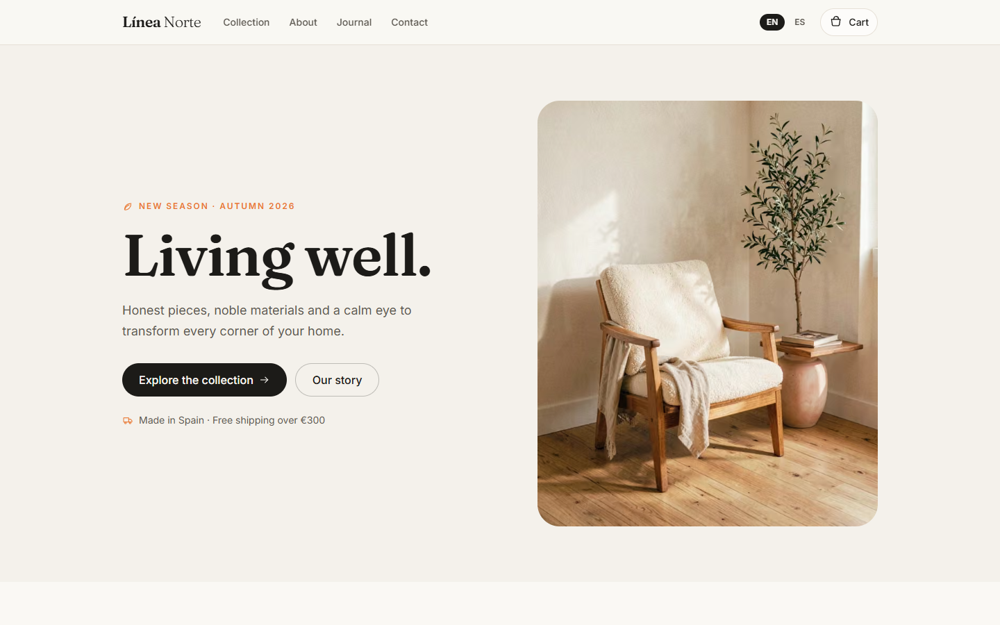

# Línea Norte

A bilingual storefront for a small Madrid furniture studio, built as an original implementation with no page templates or copied assets.



## What it is

Línea Norte is a complete front-end furniture storefront: home, a filterable collection, product detail pages, a persistent cart, an editorial journal and legal pages, in English and Spanish.

It is a demo, not a shop. There is no payment provider, backend, inventory or email service: the cart is stored in the browser and converts into a quote request, and the contact form confirms locally without sending anything.

## Why this over a store template

- **Clean-room build.** Layout, copy, palette and photography were produced for this project; no page template, copied class names or stock assets.
- **Bilingual by default.** `/[locale]` routes, typed dictionaries, automatic browser-language detection, a manual switcher, localized prices and dates, and `hreflang` alternates.
- **Market rules in one file.** Currency, formatting, flat shipping and the free-shipping threshold live in `src/config/region.ts`.
- **No remote media.** All 13 product and editorial photographs are local WebP files generated for the brand, so the page makes no third-party image requests.
- **Small dependency surface.** Next.js, React, Tailwind CSS and `sharp` at build time. No UI kit, no cart library, no state manager.
- **Content-led, not carousel-led.** A quiet editorial layout with a real journal, structured data and a catalogue that filters without a round trip.

## Quick start

Requirements: Node.js 24 (see `.nvmrc`) and pnpm 11.

```bash
git clone https://github.com/JORDANROBERTO74/linea-norte.git
cd linea-norte
pnpm install
pnpm dev
```

Open <http://localhost:3000>. The proxy redirects to `/en` or `/es` based on your browser's `Accept-Language` and remembers an explicit choice in a cookie.

| Command | What it does |
| --- | --- |
| `pnpm dev` | Start the development server on port 3000 |
| `pnpm build` | Create an optimized production build |
| `pnpm start` | Serve the production build |
| `pnpm lint` | Run ESLint |
| `pnpm typecheck` | Run `tsc --noEmit` |

## Internationalization

Copy lives in `src/i18n/dictionaries/en.ts` and `es.ts`. The English file defines the `Dictionary` type, so a missing or misspelled key in Spanish fails `pnpm typecheck` instead of rendering a blank label.

- `src/i18n/config.ts` lists the supported locales and the default (`en`).
- `src/proxy.ts` detects the locale and redirects `/` to `/{locale}`.
- `src/lib/format.ts` centralizes `Intl` formatting for prices and dates.
- Every page declares canonical and `hreflang` alternates from `src/lib/seo.ts`.

## Region and currency

All market rules live in `src/config/region.ts`:

```ts
export const region = {
  id: "es",
  currency: "EUR",
  locale: "es-ES",
  shippingFlat: 1200, // €12.00 in minor units
  freeShippingThreshold: 30000, // free over €300
} as const;
```

Prices are stored in minor units. Change those values and the store relocates: formatting, shipping and the free-shipping notice follow. Product, article and category content is localized in `src/data`.

## Catalog, cart and quote

- Eight pieces across four categories: seating, tables, lighting and storage.
- The collection filters by category on the client, with counts and an empty state.
- Cart state is a reducer persisted to `localStorage` (`linea-norte.cart.v1`); totals are pure functions in `src/lib/cart.ts`.
- There is no checkout. The cart's primary action opens the contact page so a piece can be quoted, matching how made-to-order furniture is actually sold.
- The contact form validates in the browser and shows a confirmation; no request leaves the page.

## Artwork

`public/images/*.webp` are AI-generated photographs produced with `flux-2-klein-4b` through the local `image-forge` tool, then converted to WebP at quality 82 with `sharp`. Product and hero shots use a 4:5 frame at 1024 px wide; editorial shots are 4:3. Every scene keeps the warm paper, ink and terracotta palette of the brand and carries no lettering, logos or recognisable people. Next.js negotiates AVIF or WebP at request time.

Seeds and subjects are recorded in the repository's provenance record so each image can be reproduced.

## Project structure

```text
src/
  app/[locale]/          routes: home, collection, product, about, journal, cart, contact, legal
  components/            layout, home, product, cart, journal, contact and UI primitives
  config/                site identity and region/currency settings
  data/                  localized products, categories and articles
  i18n/                  locale config, dictionaries and loader
  lib/                   cart reducer, formatting, SEO and class helpers
  providers/             cart context with localStorage persistence
  types/                 shared domain types
docs/
  screenshot.webp
```

## Deployment

The app uses the default Vercel Next.js preset; no `vercel.json` is required.

1. Import the repository and keep the detected settings (`pnpm install`, `pnpm build`, output `.next`).
2. Set `NEXT_PUBLIC_SITE_URL` to the production origin.
3. Deploy, then verify `/{en,es}`, `/sitemap.xml`, `/robots.txt`, the Open Graph images, a product page and a cart round trip.

`NEXT_PUBLIC_SITE_URL` drives canonical links, `hreflang`, `sitemap.xml`, `robots.txt` and Open Graph URLs. When it is unset, the code falls back to `https://linea-norte.vercel.app`; the public demo sets it to its Vercel origin.

Live demo: <https://linea-norte.vercel.app>

## Status and scope

This is a portfolio reference implementation, maintained but not production-ready for real orders. There is no persistence beyond the browser, no authentication and no payment integration. Verification covers `pnpm lint`, `pnpm typecheck`, `pnpm build` and a manual pass over both locales at desktop and mobile widths.

## License

Proprietary, all rights reserved. See [LICENSE](LICENSE). Third-party dependencies remain under their own licenses. The Línea Norte brand, product names, copy and photography are fictional and included for demonstration.
